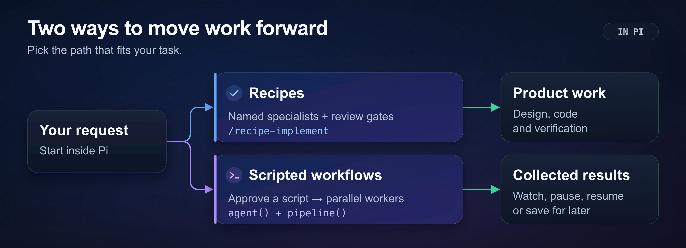

# pi-workflows

pi-workflows adds development recipes and scripted workflows to [Pi](https://github.com/earendil-works/pi). Recipes use specialist agents; scripted workflows coordinate parallel workers.



*A recipe guides one change. A scripted workflow splits repeated tasks across workers and collects their results.*

## Install and start

pi-workflows requires Pi 1.0.0 or later. Recipe agents also require [Pi Subagents](https://github.com/fitchmultz/pi-subagents) 0.44.4 or later.

Run these commands from your project directory:

```bash
pi install npm:@fitchmultz/pi-subagents
pi install npm:@fitchmultz/pi-workflows
pi
```

Then run this command in Pi:

```text
/workflows
```

`/workflows` lists 17 recipes, 31 skills and 25 agents. It reports missing recipe tools.

Recipes also require `todo_list`, `ask_question` and `agent_browser_web_search`. Install their providers before you start a recipe.

## Choose a recipe

Recipes use named agents and include approval points. Type `/recipe` to see recipe commands.

| Task | Command |
| --- | --- |
| Plan a feature | `/recipe-design Add account recovery` |
| Build a backend or general change | `/recipe-implement Add rate limiting to the public API` |
| Investigate a bug | `/recipe-diagnose Login returns 500 after deploy` |
| Design frontend screens | `/recipe-front-design Add account recovery screens` |
| Build a full-stack feature | `/recipe-fullstack-implement Add account recovery` |
| Review a design | `/recipe-review docs/design/rate-limit.md` |

For frontend work, run `/recipe-front-design`. Next, run `/recipe-front-plan`. Then run `/recipe-front-build`.

## Run a scripted workflow

Use a scripted workflow for repeated tasks across many files. Ask Pi to write one:

```text
use a workflow to audit every route handler under src/routes/ for missing auth
```

The editor highlights the trigger phrase. Press Alt+W / Option+W to dismiss the highlight.

The terminal UI shows these choices before the script runs:

| Choice | Action |
| --- | --- |
| Once | Run the script once. |
| Always | Skip future approval for this workflow name in this project. |
| View | Read or edit the script. Then return to the approval card. |
| Deny | Cancel the script before it runs. |

Run `/deep-research <question>` to use the bundled research script.

Scripted workers use native file and shell tools. They do not inherit recipe agents or browser tools.

Workers can change files and run shell commands. Approve only scripts you trust. The runtime has no security sandbox or CPU deadline.

RPC requests confirmation for names without Always approval. Non-UI mode runs scripts without confirmation.

Each worker makes model calls. Large runs use more of your model allowance.

## Control a run

Use `/workflows` to view, pause, resume, stop or save a run. Runs and the resume cache last for the current extension session.

Save writes the script to `.pi/workflows/<name>.js`. Pi adds the `/<name>` command in the next session.

`/workflow-size` shows the agent-count guideline. Set it with `/workflow-size small`, `medium`, `large` or `unrestricted`. The default is `medium`: fewer than 15 agents.

The runtime permits at most 16 workers at once and 1,000 calls per run. Size guidelines do not change these limits.

## More detail

Read [Scripted workflows](docs/scripted-workflows.md) for script examples, worker results and resume behavior.

Read [Development](docs/development.md) for Git installs, the repository layout and build commands. [Pi contracts and qualification](docs/pi-1.0.md) documents exact host versions and compatibility checks.

Read the [changelog](CHANGELOG.md) for changes. Report problems or suggestions in [issues](https://github.com/fitchmultz/pi-workflows/issues).

## License

[MIT](LICENSE).
